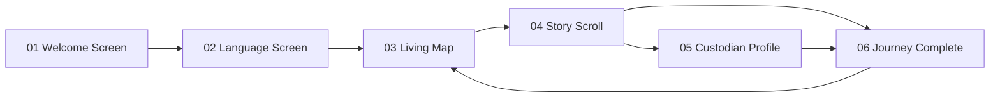

# System Architecture & Technical Specifications

Custodian is an expedition-grade digital field journal engineered around community-owned cultural preservation. Grounded in the principle that **"AI translates culture; it does not invent it,"** the platform embeds consent, native linguistic sovereignty, spatial context, and cultural boundaries into every layer of interaction.

---

## 🏛️ Core Design Principles

1. **Provenance Over Performance:** Every piece of cultural content is attributed to verified knowledge keepers, complete with regional genealogy, oral lineage, and community seals.
2. **Custodian-Controlled Consent (Tiered Access):** Knowledge holders determine visibility tiers. Private rites and secret green-room consecrations are intentionally protected by cryptographic and UI-level boundaries.
3. **Native Linguistic Sovereignty:** Stories are recorded in native spoken dialects (Kannada, Tulu, Malayalam). RAG-assisted translation acts as a bridge for travellers without diluting indigenous phonetics.
4. **Restrained Pacing & Tactile Purity:** The interface models a tangible parchment field journal (80% warm paper surfaces, 15% supporting tones, 5% terracotta accents) with physical motion primitives.

---

## 🗺️ Screen Navigation Flow



### 1. Screen 01: Welcome Screen
* Serves as the philosophical orientation and onboarding portal.
* Establishes the three architectural pillars:
  * **Parchment:** Tactile, calm paper surfaces with restrained grain.
  * **Journal:** Serif field-note narratives with verified community provenance.
  * **Map:** Cartographic discovery with wax-seal markers and boundary perimeters.

### 2. Screen 02: Language Screen
* Dialect and locale selection interface.
* Supports English, Kannada, Tulu, and Hindi.
* Highlights oral provenance safeguards, preserving indigenous place names and chants in original phonology.

### 3. Screen 03: Living Map
* Interactive stylized cartographic canvas of coastal Karnataka and the Western Ghats.
* Renders natural terrain features:
  * Arabian Sea coastal basin with ink linework.
  * Ancient river systems (Swarna, Netravati).
  * Sahyadri mountain ridgelines and ancient roads.
* Features interactive waypoint markers with status rings: standard, selected, completed, and custodian-protected.
* Integrated collapsible narrative preview sheet.

### 4. Screen 04: Story Scroll
* Immersive long-form field journal layout.
* Features typographic hierarchy with Cormorant Garamond pull-quotes and Inter body copy.
* Houses the synchronized **Audio Experience**:
  * Real-time audio waveform / scrubber controls.
  * Multi-tab synchronized transcripts across regional dialects.
  * Custodian voice status banner.
* Contains the **Custodian Boundary** component for sacred, non-public lore.

### 5. Screen 05: Custodian Profile
* Details the verified knowledge keepers behind each tradition.
* Visualizes:
  * Custodian monogram crest and verified provenance seal.
  * Hereditary lineage and training history.
  * Living Culture Charter covenant statement.
  * Community elders verification badges.

### 6. Screen 06: Journey Complete
* Expedition culmination and cultural reflection ledger.
* Features an animated verified wax-stamp seal.
* Expedition summary metrics (visited territories, trust adherence, audio duration).
* Traveler reflection ledger for mindful participation.

---

## 🔊 Audio Synthesis & Soundscape Architecture

The audio layer in `src/utils/audioEngine.js` combines three distinct technologies to create an authentic living soundscape:

1. **Pre-recorded Custodian Audio:** Authentic field recordings streamed from `/audio/field-note-*.wav`.
2. **Web Speech Synthesis (SpeechSynthesis API):** Real-time multilingual voice synthesis utilizing Indic speech engines (`kn-IN`, `hi-IN`, `en-IN`) with natural elder pacing (0.88x rate, 0.92 pitch).
3. **Web Audio API Acoustic Drone:**
   * Fundamental drone: 146.83 Hz (D2) triangle oscillator mimicking an acoustic tanpura.
   * Harmonic overtone: 220.0 Hz (A3) sine oscillator.
   * Periodic bronze temple bell chime: 587.33 Hz (D5) with exponential decay triggered every 12 seconds.

---

## 🛡️ Custodian Boundary Framework

When a cultural tradition contains private hereditary knowledge, the system enforces a `CustodianBoundary`:

```javascript
custodianBoundary: {
  hasBoundary: true,
  boundaryTitle: "Purvaranga: The Sacred Dressing Sanctum",
  reason: "This part of the tradition isn't publicly shared.",
  explanation: "Confidential hereditary rites reserved solely for initiated performers and hereditary gurus.",
  respectNote: "Respect the boundary. Appreciate public performance while honoring private ritual hearth."
}
```

The UI presents a locked perimeter with an acknowledgment button, transforming access limits into an active exercise of cultural respect.
