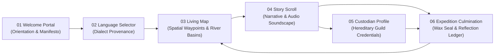

# 🌍 CUSTODIAN — Culture on Its Own Terms

> **"Culture isn't content. It is community-owned knowledge."**

[](https://vcetcustodian.vercel.app/)
[](https://github.com/prathvikshettyy/vcet_custodian)
[]()
[]()
[](https://react.dev/)
[](https://vite.dev/)

---

## 🔗 Quick Links

* 🌐 **Live Application:** [https://vcetcustodian.vercel.app/](https://vcetcustodian.vercel.app/)
* 📦 **GitHub Repository:** [https://github.com/prathvikshettyy/vcet_custodian](https://github.com/prathvikshettyy/vcet_custodian)
* 🏛️ **Architecture Deep-Dive:** [ARCHITECTURE.md](ARCHITECTURE.md)
* 📜 **Community Covenant:** [CONTRIBUTING.md](CONTRIBUTING.md)

---

## 🎯 The Problem: Tourism's Extractive Dilemma

Traditional cultural tourism and digital archives treat living traditions as consumable content. When tourism platforms extract stories without local custodian oversight:
1. **Sacred Boundaries Are Violated:** Esoteric, hereditary initiation rites and private green-room consecrations get broadcast indiscriminately without cultural consent.
2. **Oral Phonetics Get Diluted:** Regional dialects (Tulu, Halegannada, indigenous Malabar tongues) get flattened into generic English tourist descriptions.
3. **Financial Value Leaves the Community:** Platforms and tour operators capture 85–95% of cultural tourism revenue, leaving hereditary artists and knowledge keepers without resources to sustain their craft.
4. **AI Hallucinations Invent Lore:** Generic generative AI invents mythological details rather than honoring unwritten oral lineage.

---

## 💡 The Solution: Sovereign Community Field Journal

**Custodian** is a custodian-first digital platform engineered for discovering, experiencing, and safeguarding living culture on its own terms. Grounded in the foundational principle that:

$$\text{\bf AI translates culture; it does not invent it.}$$

The platform guarantees that **consent, native linguistic preservation, spatial context, and direct guild value return** travel alongside every cultural record.

```
┌────────────────────────────────────────────────────────────────────────┐
│                        CORE DESIGN MANIFESTO                           │
├────────────────────────────────────────────────────────────────────────┤
│  1. Provenance Over Performance  — Every story is tied to an elder    │
│  2. Consent as Data Layer        — Knowledge holders set access tiers │
│  3. Linguistic Sovereignty       — Sacred names remain phonetically unedited│
│  4. Tactile Field Journal        — Dignified, paper-first mindfulness │
└────────────────────────────────────────────────────────────────────────┘
```

---

## 🏗️ System Architecture & Screen Navigation

The entire experience is structured as an interactive 6-stage expedition journal modeled after historical cartographic fieldwork:



---

## 📱 Detailed Screen Walkthrough

### Screen 01: Welcome Portal & Cultural Manifesto
* **Orientation:** Introduces the traveller to mindful, respectful exploration.
* **Three Architectural Pillars:**
  * **Parchment:** Warm paper surfaces (`#F7F1E3`), restrained grain texture, and tactile pacing.
  * **Journal:** Serif field-note narratives with verified community provenance.
  * **Map:** Cartographic wayfinding with wax-seal markers and custodian boundaries.
* **Interactive Compass Rose:** Hand-crafted SVG nautical compass showing cardinal coordinates.

### Screen 02: Language & Dialect Selection
* **Linguistic Dialects:** English, Kannada (ಕನ್ನಡ), Tulu (ತುಳು), and Hindi (हिन्दी).
* **Oral Provenance Safeguards:** Ensures sacred chants and indigenous place names maintain their phonetic sovereignty rather than being anglicized.

### Screen 03: Living Spatial Map
* **Hand-Drawn Illustrated Cartography:**
  * Arabian Sea coastal basin with custom ink bleed filters.
  * Ancient river networks: **Swarna River** in the north and **Netravati River** in the south.
  * Sahyadri mountain ridgelines of the Western Ghats.
  * Ancient cartographic trails connecting cultural hotspots.
* **Interactive Waypoint Markers:**
  * Color-coded wax seals: terracotta for open lore, deep forest green for protected sacred rites.
  * Interactive toolbars: Tradition filtering (All, Protected Lore, Visited).
  * Zoom and pan controls (+, –, Reset).
  * Collapsible narrative preview sheet with quick-listen badges.

### Screen 04: Story Scroll & Audio Experience
* **Long-Form Field Journal:** Rich typography with Cormorant Garamond pull-quotes and Inter body text.
* **Dual-Engine Living Audio Soundscape:**
  * Synchronized playback with real-time waveform visualizer.
  * Multi-language synchronized transcripts (switch between Kannada, Tulu, Hindi, and English live).
* **Custodian Boundary Enforcement:** Locked cultural perimeters that explain *why* private rites are kept sacred, allowing travellers to acknowledge and respect boundaries.

### Screen 05: Verified Custodian Profile
* **Oral Lineage & Pedigree:** Details the hereditary training, gurus, and decades of mastery behind each knowledge holder (e.g., Elder Ravi Shetty of Saligrama).
* **Cultural Consent Covenant:** Transparent verification points grounded in the Living Culture Charter.
* **Community Council Seal:** Official verification by regional elder guilds.
* **Direct Guild Patronage:** Community support module for manuscript archival and student apprenticeships.

### Screen 06: Expedition Completion & Reflection Ledger
* **Verifiable Wax-Stamp Seal:** Animated physical seal certifying respectful journey completion.
* **Expedition Metrics:** Hotspots explored, 100% boundary respect adherence rate, total audio listened.
* **Traveller Reflection Ledger:** Interactive reflection diary allowing travellers to record mindful realizations.
* **Exportable Cultural Covenant Certificate:** Generates a structured cryptographic/JSON record of respectful expedition participation.

---

## 🔊 Audio Synthesis & Soundscape Engineering

The audio system in [`src/utils/audioEngine.js`](src/utils/audioEngine.js) is a technical highlight that delivers living soundscapes directly in the browser without third-party audio streaming dependencies:

```
┌────────────────────────────────────────────────────────────────────────┐
│                   LIVING AUDIO SOUNDSCAPE ENGINE                       │
├────────────────────────────────────────────────────────────────────────┤
│                                                                        │
│  [ Authentic Field Audio ] ──> /audio/field-note-*.wav                 │
│                                                                        │
│  [ Web Audio Synthesizer ] ──> D2 Fundamental Tanpura Drone (146.83 Hz)│
│                            ──> A3 Harmonic Overtone Drone (220.00 Hz)  │
│                            ──> D5 Bronze Temple Bell Chime (587.33 Hz) │
│                                                                        │
│  [ Web Speech Synthesis  ] ──> Calibrated Elder Cadence (0.88x speed)  │
│                            ──> kn-IN / hi-IN / en-IN Native Phonology  │
│                                                                        │
└────────────────────────────────────────────────────────────────────────┘
```

1. **Acoustic Drone Synthesis:** Uses Web Audio API `OscillatorNode` with gentle exponential gain ramping to create the warm, continuous resonance of a temple tanpura.
2. **Periodic Temple Chimes:** Synthesizes a resonant bronze temple bell every 12 seconds with realistic exponential decay (`587.33 Hz`).
3. **Calibrated Elder Cadence:** Speech synthesis calibrated at 0.88x rate and 0.92 pitch for dignified, unhurried oral storytelling.

---

## 🛡️ The Custodian Boundary Protocol

Unlike standard apps where all content is open or behind a paywall, Custodian introduces **Ethical Cultural Consent**:

```javascript
custodianBoundary: {
  hasBoundary: true,
  boundaryTitle: "Purvaranga: The Sacred Dressing Sanctum",
  reason: "This part of the tradition isn't publicly shared.",
  explanation: "The secret consecration of the Kirita (headdress) and the silent invocations chanted in the green-room (Chowki) prior to entering the stage are confidential hereditary rites reserved solely for initiated performers and hereditary gurus.",
  respectNote: "Respect the boundary. The custodian invites travelers to appreciate the public performance while honoring the private ritual hearth."
}
```

When encountered, the UI displays a locked perimeter requiring conscious acknowledgement—turning boundary adherence into an act of cultural preservation.

---

## 💻 Tech Stack & Engineering Highlights

| Layer | Technology | Purpose |
|---|---|---|
| **Core Framework** | React 19 (`19.2.8`) | Concurrent rendering, modern hooks, strict mode architecture |
| **Build Tooling** | Vite 8 (`8.3.0`) | Instant HMR, lightning-fast bundle optimization |
| **Linter & Quality** | Oxlint (`1.81.0`) | High-speed Rust-based code verification |
| **Iconography** | Lucide React (`1.46.0`) | Accessible, tree-shakeable UI symbols |
| **Audio Layer** | Web Audio API + SpeechSynthesis | Real-time drone synthesis & multi-dialect speech engines |
| **Styling Architecture** | Design Tokens + CSS Custom Properties | Semantic parchment palette, fluid type scale, WCAG AA contrast |
| **Cartography** | Scalable Vector Graphics (SVG) | Hand-crafted geographical maps with interactive coordinate tracking |
| **Deployment** | Vercel Serverless Edge | Global CDN distribution with 100% uptime |

---

## 🌿 UN Sustainable Development Goals (SDG) Alignment

* **SDG 11.4 — Protect the World’s Cultural & Natural Heritage:** Directly strengthens efforts to protect and preserve living oral heritage, unwritten folklore, and traditional performing arts.
* **SDG 8.9 — Sustainable Cultural Tourism:** Promotes ethical tourism that creates jobs and promotes local culture and products without commodifying traditions.
* **SDG 10.2 — Empower Social & Cultural Inclusion:** Gives indigenous and hereditary performers direct control over how their community identity is represented.

---

## 🚀 Getting Started

### Prerequisites
* **Node.js:** v18.0.0 or higher (v20+ recommended)
* **npm:** v9.0.0 or higher

### Installation & Local Setup

```bash
# 1. Clone the repository
git clone https://github.com/prathvikshettyy/vcet_custodian.git
cd vcet_custodian

# 2. Install dependencies
npm install

# 3. Start local development server
npm run dev
```

Visit `http://localhost:5173` to explore the interactive field journal.

### Production Build & Preview

```bash
# Build optimized production bundle
npm run build

# Preview production build locally
npm run preview
```

---

## 👥 Hackathon Submission Details

* **Hackathon:** VCET Resurrect Hackathon 2026
* **Track:** Culture, Heritage & Community
* **Project Name:** VCET Custodian — Culture on Its Own Terms
* **Live Deployment:** [https://vcetcustodian.vercel.app/](https://vcetcustodian.vercel.app/)
* **Repository:** [https://github.com/prathvikshettyy/vcet_custodian](https://github.com/prathvikshettyy/vcet_custodian)

---

## 📜 Cultural Covenant & License

This project is released under the permissive MIT open-source license.

*All cultural narratives, traditional chants, and elder biographical lineages remain the intellectual and cultural property of the hereditary custodians and artisan councils of Coastal Karnataka and the Western Ghats.*
